<div align="center">

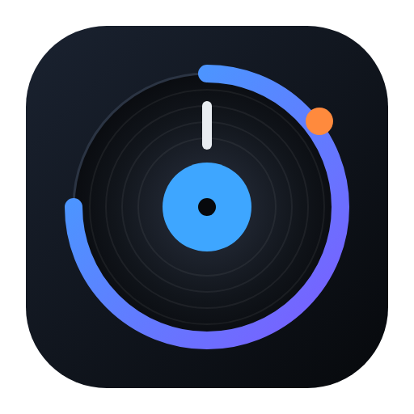

# OpenDJ

**Free, open-source DJ software for your own music.**
Decks, mixer, AI stems, automix, controllers, video and lights, with a library that pulls from your folders, USB sticks, NAS and media servers.

[](LICENSE)
[](https://github.com/Bucifer6/OpenDJ/releases/latest)
[](https://github.com/Bucifer6/OpenDJ/actions/workflows/build.yml)


[**Download**](https://github.com/Bucifer6/OpenDJ/releases/latest) · [Features](#features) · [Quick start](#quick-start) · [Comparison](docs/GAP_ANALYSIS.md) · [Contributing](CONTRIBUTING.md)

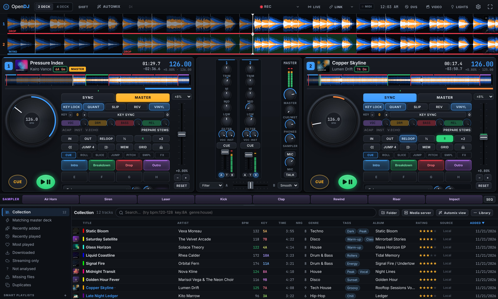

</div>

<sub>All screenshots use a fictional demo library (invented artists, titles and cover art) synthesised by [`scripts/demo/make-demo-library.mjs`](scripts/demo/make-demo-library.mjs).</sub>

## Why OpenDJ

- **Free and open source.** MIT licensed. No subscription, no account, no feature locked behind a paywall.
- **Your music, wherever it lives.** Local folders, USB sticks and NAS shares, plus your own **Plex, Jellyfin, Emby, Subsonic/Navidrome and MediaMax** servers. Stream from them or download tracks for offline gigs.
- **Runs everywhere.** Desktop app for Windows, macOS and Linux, or a self-hosted web app (Docker / NAS) you open in Chrome or Edge.
- **Plays nicely with your other tools.** Imports rekordbox, Traktor, Serato and VirtualDJ libraries; exports rekordbox XML, M3U and CDJ-ready USB sticks.

<p align="center">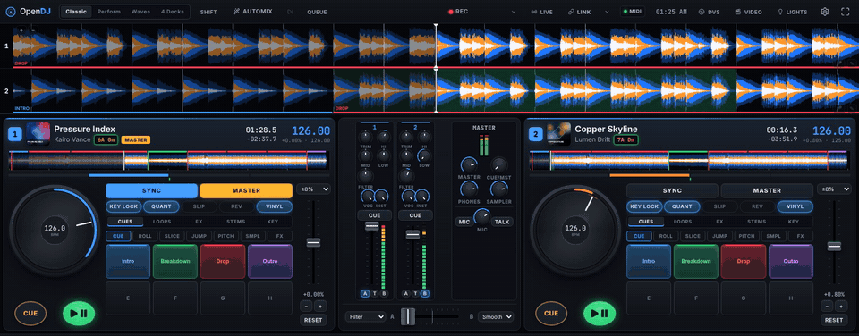</p>

## Features

### Decks & mixer

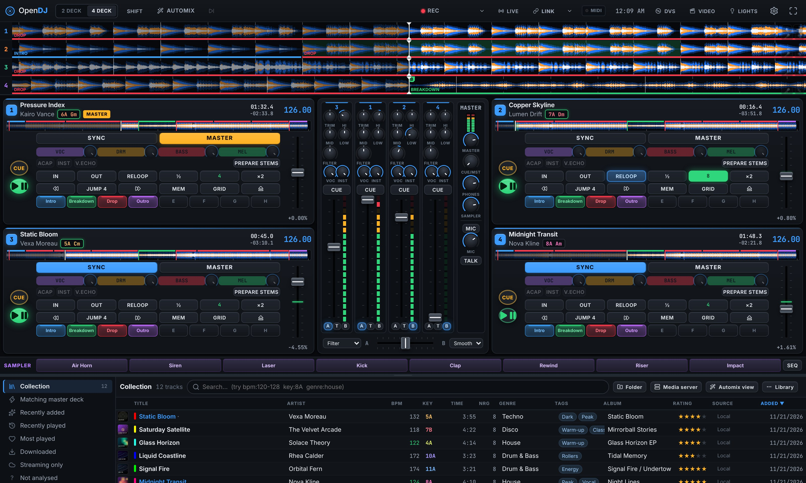

- 2 or 4 decks on a sample-accurate AudioWorklet engine
- **Key lock** (WSOLA time-stretching), tempo ranges ±6 % to ±100 %, pitch bend and nudge
- **Key shift** (±12 semitones) and **Key Sync** to the nearest harmonically compatible key of the master deck
- **Sync** (tempo + phase, half/double-time aware) with a **phase meter**; phase-locked hot cue jumps; **instant doubles** (drag a deck header onto another deck)
- CDJ-style cue, 8 colour-coded **hot cues**, memory cues and **saved loops**
- Pad modes: Hot Cue, Roll, **Slicer**, Beat Jump, **Pitch Play**, Sampler, Pad FX
- Auto loops (⅛ to 64 beats), loop roll, beat jump, quantize, **slip**, reverse, censor
- Jog wheels with vinyl scratch, nudge, motor brake and backspin
- Scrolling 3-band colour waveforms with beat grid, cue, loop and **phrase** markers, plus a full-track overview; beat grid editor with tap tempo
- Mixer: trim, selectable **EQ presets** (isolator, classic full-kill, 4-band, rotary, battle, vintage, sculpt), one-knob or dual HP/LP filter, **Color FX** (Filter, Space, Dub Echo, Noise, Crush, Jet, Sweep, Crunch, Pitch), headphone cue A/B, RMS meters and an EBU R128 loudness card, full-width crossfader with a continuous curve, hamster reverse and a 1 ms fast cut, fader curves, master limiter, auto-gain
- Mixer extras (Advanced mixer drawer): booth output with booth EQ, mic EQ / FX / auto talkover, two beat FX units with an FX strip, send / return, channel compressor, master isolator, warmth, record level, and optional **personalities** (Club, Classic, Rotary, Battle)
- 10 beat-synced effects per channel (Echo, Ping Pong, Reverb, Flanger, Phaser, Auto Filter, Trans, Bit Crusher, Distortion, Noise Sweep) with **post-fader tails** (echo and reverb keep ringing when you close the fader, for echo-outs; switchable to pre-fader in Settings → Audio) and pad FX (brake, tape stop, backspin, echo out, filter sweep, rolls)
- 8-slot sampler with a bank of synthesised DJ FX (air horn single blast and "ba-ba-baaah" triplet, dub siren, laser, rewind, vinyl stop, riser, downlifter, impact, noise sweep, clap, kick), rendered with Web Audio and loudness-matched; per pad: choose a sound, load your own sample, pad volume, **sync to beat**. Plus a **16-step sequencer** locked to the master deck, microphone / aux input with **talkover**, MIDI clock out
- Headphone cueing on a second sound card, on channels 3-4 of a 4-channel controller interface, or as split cue on one stereo jack

### AI stems

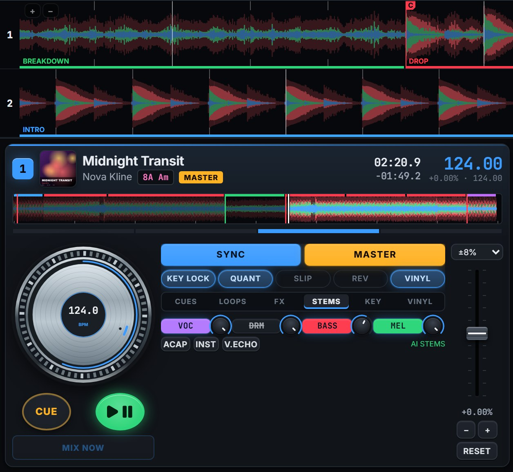

- Right-click a track → **Prepare AI stems**. Separation runs on your computer with HT-Demucs (ONNX Runtime; WebGPU when available) and is cached per track.
- Each deck gets **vocals / drums / bass / melody** mute and level, **acapella**, **instrumental** and **vocal echo**.
- The model (~98 MB) is downloaded only after you agree; see [the licence note](#licence). Separation on the CPU is slow (roughly 2.5× the track length), so prepare tracks before the gig.
- Without prepared stems, the VOC / INST knobs use fast DSP vocal isolation (quick stems).

### Library & media servers

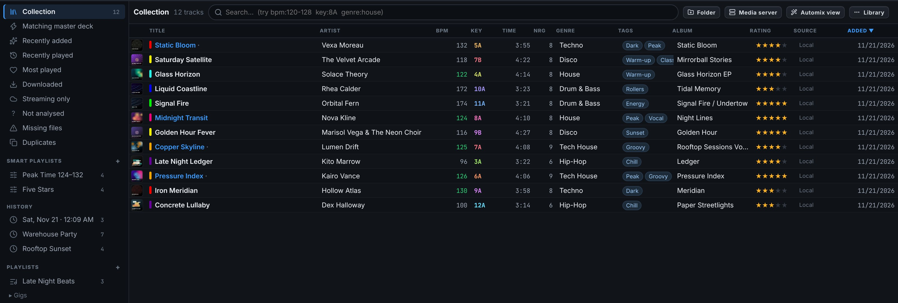

- Folders on any drive; **USB sticks and NAS shares** (SMB/NFS/AFP/SSHFS mounts) are detected and added with one click
- **Media servers**: Plex, Jellyfin, Emby, Subsonic-compatible (Navidrome, Airsonic, Gonic…) and MediaMax (including its DJ analysis). Each server's **playlists** show up live under it in the sidebar: open one, automix / shuffle & mix / smart mix it, import it as a local playlist or download it all. Tracks stream through a local proxy with seeking, or **download** them for offline use.
- Automatic analysis: BPM + beat grid, key (Camelot), energy, loudness, silence trimming, **phrases** and automatic cues. New tracks are analysed **in the background** after a scan or upload, one at a time and paused while a deck loads (progress and a stop button in the library toolbar; *⋯ Library → Analyse all tracks* or right-click → *Analyse* to start it by hand; *Settings → Library* turns it off). Tracks with a locked BPM or an imported beat grid keep it; streaming-only media-server tracks are analysed when loaded or when you ask. Files that can't be decoded are flagged ⚠ in the list.
- Playlists with folders, **smart playlists** (rules for BPM, key compatibility, genre, tags, colour, rating, energy, dates…), track **colours**, **My Tags**, ratings, **play history sessions** with setlist export (TXT/CSV/M3U)
- Track info editor (single and multi-track), duplicate finder, missing-file relocate, library backup / restore
- Search with filters such as `bpm:120-128`, `key:8A`, `genre:house`, and a *Matching master deck* view (harmonic key + tempo)
- Import **rekordbox XML**, **Traktor NML**, **Serato crates**, **VirtualDJ database** and M3U; export rekordbox XML, M3U8 or playlists to a USB folder. Serato keeps BPM, cues and grids inside the audio files' tags, not in its crates, so a Serato import brings in the crates (as playlists) and their tracks; OpenDJ then analyses them itself.

### Automix

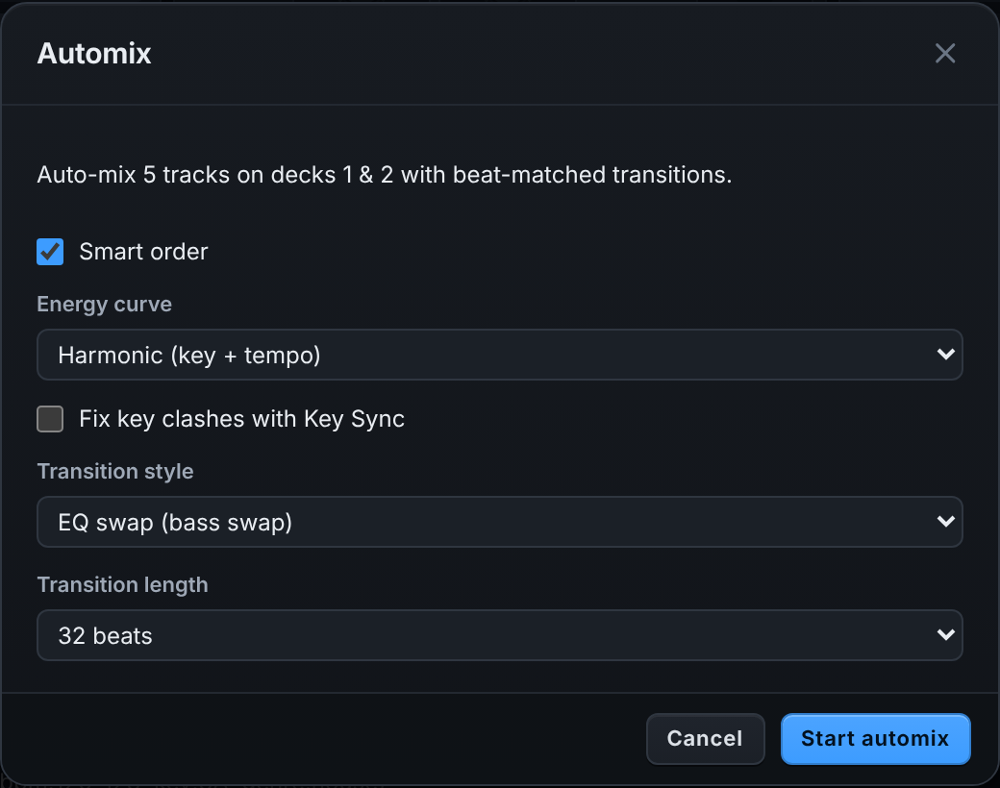

- Non-stop mixing of any playlist or library view on decks 1 and 2. **One click on AUTOMIX** starts a smart mix of the queue (or, without one, of the playlist / library view shown) with your saved preferences; click it again to stop. **Shift-click or right-click AUTOMIX** (or **Automix view** above the track list, or a playlist's menu) opens the Automix dialog with order, mix profile, transition style and length. While automix runs, each deck's **MIX NOW** starts the next transition at once
- Beat-matched, **phrase-aligned** transitions in 10 **mixing styles** that drive the real EQ, filter and FX: smooth blend (bass swap on the phrase), quick bass swap, crossfade, filter sweep, echo out, cut on the downbeat, backspin, vinyl brake, loop out (rolling loop) and reverb wash, or **Auto**, which picks one per transition from the BPM jump, energy change, key and genre. Length 4–32 bars, "vary styles", and a per-transition override in the **queue panel**, which also shows the next transition's style and when it starts. Afterwards the new track eases back to its original tempo over 8 bars (can be turned off)
- **Smart mix**: orders a playlist, crate, media-server playlist, search result or the whole library by how well tracks go together (Camelot compatibility, BPM incl. half/double time, energy flow toward a set shape such as warm-up → peak → cool-down, genre/tags, no repeated artists or recently played tracks, intro phrases), or picks each next track live while playing; each transition is explained ("8A → 9A, 124 → 126 BPM, energy +1, same genre"). Presets plus harmonic / energy / variety sliders. **Shuffle & mix** plays a random order, still beat-matched
- Loading a track on a deck while automix runs works like a pro DJ app: on the next deck it becomes the next track, on the playing deck automix asks (play next / stop and load), during a transition it is queued; optional Key Sync fixes key clashes

### Controllers, DVS & Ableton Link

<table>
<tr>
<td width="50%">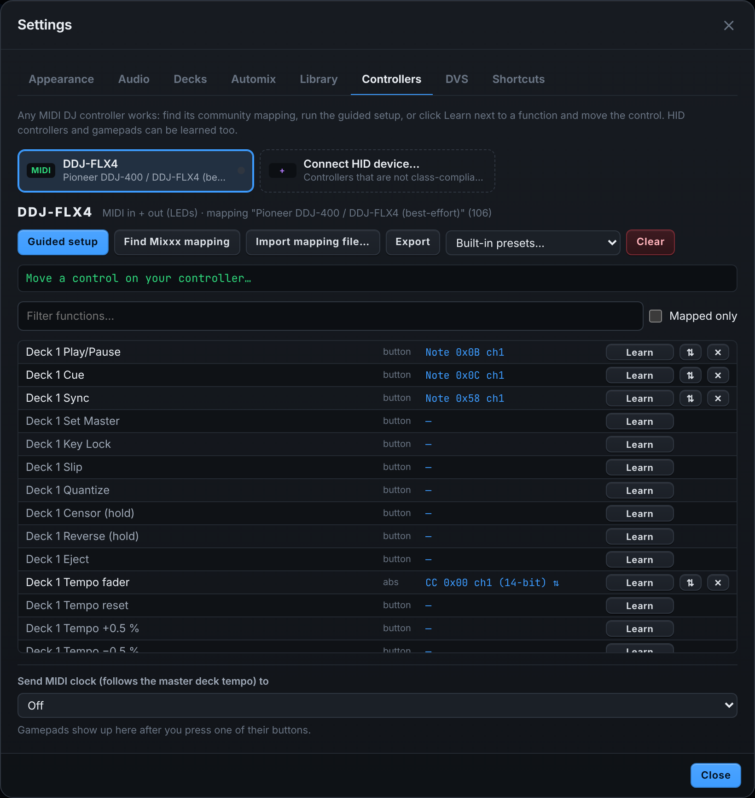</td>
<td width="50%">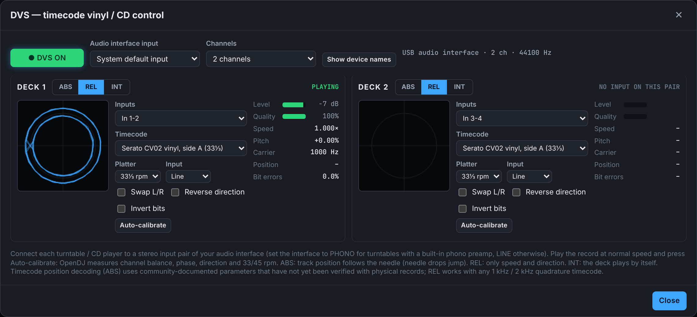</td>
</tr>
</table>

- Any class-compliant **MIDI controller** (Web MIDI) with **MIDI Learn**: 14-bit faders, relative jogs and encoders, LED feedback and a shift layer
- Import **Mixxx community mappings** (hundreds of controllers) with online search, a **guided mapping wizard**, generic **HID** devices and gamepads; mappings auto-load per device and export as JSON
- Bundled mappings, loaded automatically when the controller is plugged in:
  - **AlphaTheta DDJ-FLX2**: first-party mapping from the manufacturer's MIDI chart, with LEDs, pad modes and shift layers, SMART FADER and SMART CFX, plus the matching *Compact Controller* skin (Settings → Controllers → Controller test helps check it on your unit)
  - Pioneer DDJ-400 / DDJ-FLX4 (best-effort); if a control doesn't respond, fix it with Learn
- **Controller skins** (Settings → Appearance): *Compact Controller* and *All-in-One 4-Channel* draw the decks and mixer as hardware and follow the real controller
- **DVS**: control decks with Serato CV02 or Traktor MK1/MK2 timecode vinyl and CDs (relative, absolute and internal modes, auto-calibration). *Absolute mode has not been verified with real timecode media yet.*
- **Ableton Link**: follow or lead the session tempo with bar-phase lock (own protocol implementation). *Not yet tested against Ableton Live itself.*

### Video & lighting

<table>
<tr>
<td width="50%">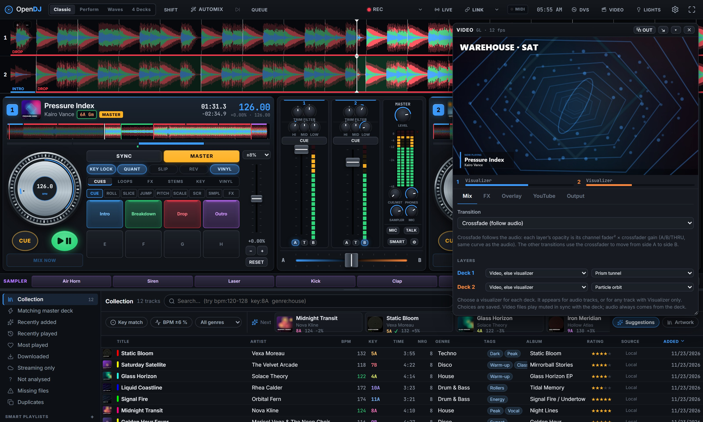</td>
<td width="50%">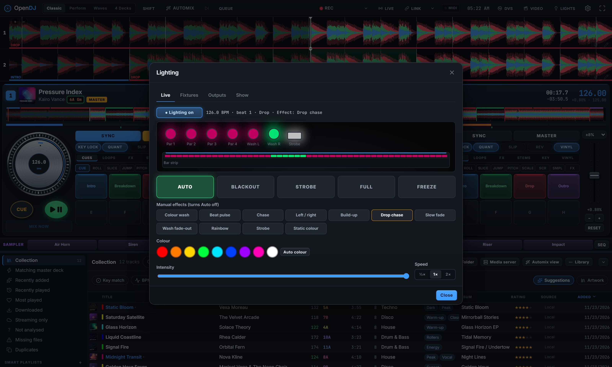</td>
</tr>
</table>

- **Video mixing**: music videos play in sync with the decks; audio-only tracks get an audio-reactive visualizer with their cover art. Transitions, video FX, text / logo / now-playing overlays, and a projector or second-screen output window. YouTube visuals through the official embedded player.
- **Lyrics & karaoke**: LRC files, embedded tags, media servers or opt-in LRCLIB; a lyric line under each deck, karaoke mode, karaoke layer in the video output and a sync editor.
- **Lighting**: automatic beat- and phrase-synced light shows (intro wash, build-up chase, drop chase with strobe accents, breakdown fade), coloured from the track's key or energy. Outputs: **Art-Net**, **sACN (E1.31)**, **USB DMX** (Enttec DMX USB Pro-compatible), **WLED**, **Philips Hue**, **OSC** and **MIDI**. Fixtures are patched from templates; live pads for blackout, strobe, full, freeze, colour, intensity and speed.

### Recording & broadcasting

<table>
<tr>
<td width="50%">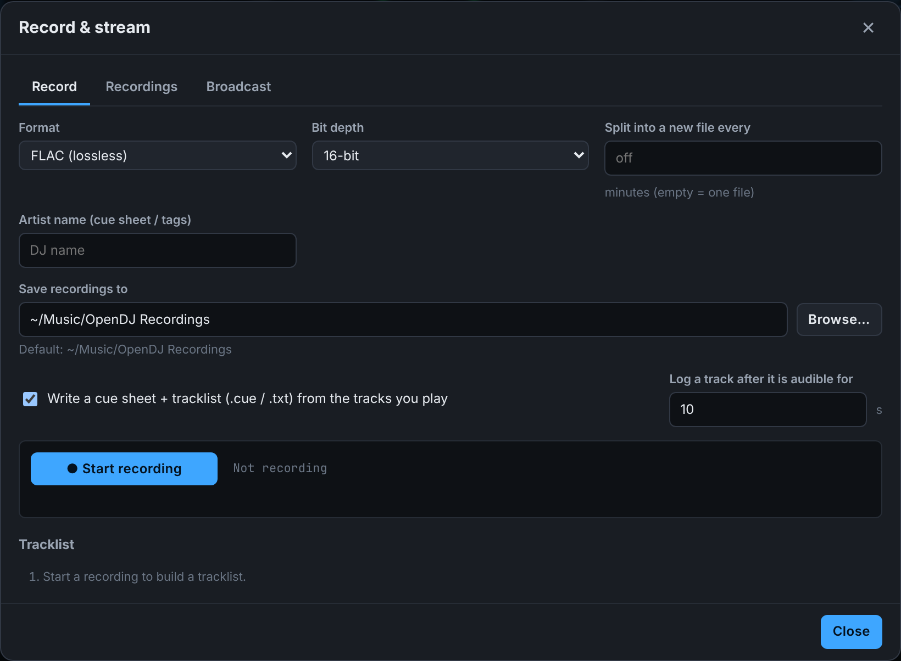</td>
<td width="50%">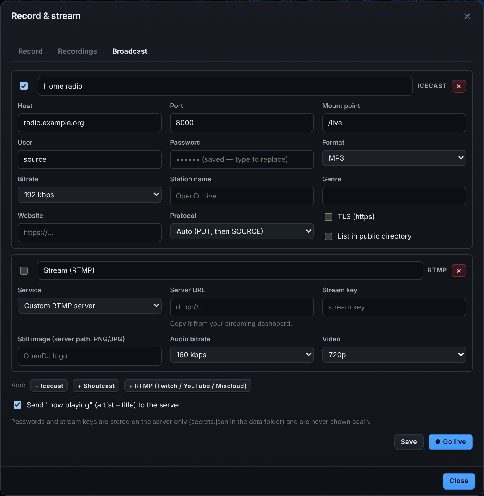</td>
</tr>
</table>

- Record your mix **straight to disk** as WAV, FLAC, MP3, AAC or Opus with no memory limit, optional auto-split per track, and `.cue` / `.txt` tracklists
- **Go live** to Icecast, Shoutcast or RTMP (Twitch, YouTube, Mixcloud) with now-playing titles

### CDJ export

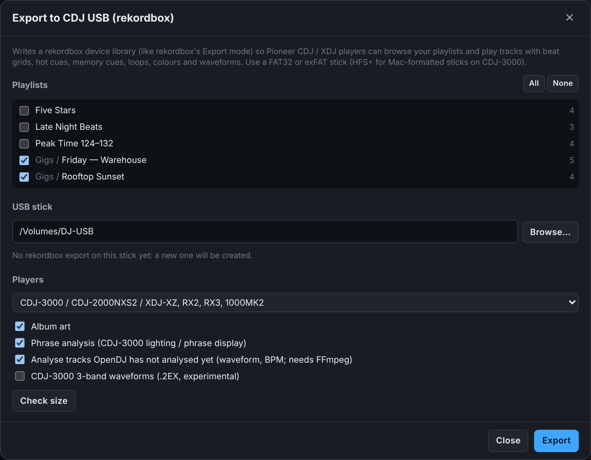

- Writes a rekordbox-style **device library** (`export.pdb` + ANLZ files) to a USB stick: beat grids, hot cues, memory cues, loops, colours, waveforms, phrases and artwork, so Pioneer CDJ / XDJ players can browse your playlists
- Validated against rekordbox's own files and three independent parsers. *It has not been tested on a player yet: feedback from CDJ owners is very welcome.*

### Web app / NAS

Run OpenDJ on a NAS or home server and open it from any computer's browser: password login, browser uploads, an installable PWA (installing needs HTTPS or `localhost`) and a Docker image. Tablets and computers are recommended; phones get a simplified one-deck-at-a-time layout. The server holds the library and streams the files; **the audio is mixed and played in the browser**, so headphones and controllers plug into the computer you browse from. See [Run as a web app](#run-as-a-web-app--on-a-nas).

### Themes

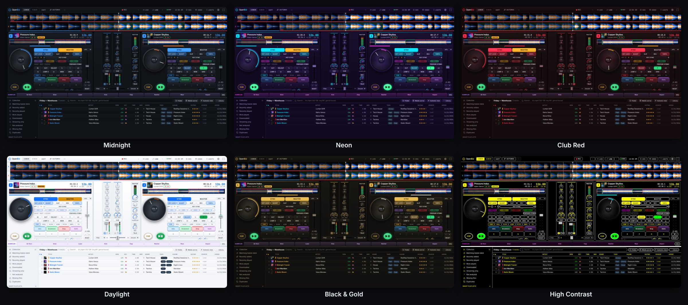

Nine themes in *Settings → Appearance*: Midnight, Graphite, Club Red, Neon, Ocean, Black & Gold, Forest, **Daylight** (a light theme for outdoor gigs) and **High Contrast**. Pick a custom accent colour, a waveform colour scheme, and scale the interface from 80 % to 150 % for small laptops or touchscreens.

<p align="center">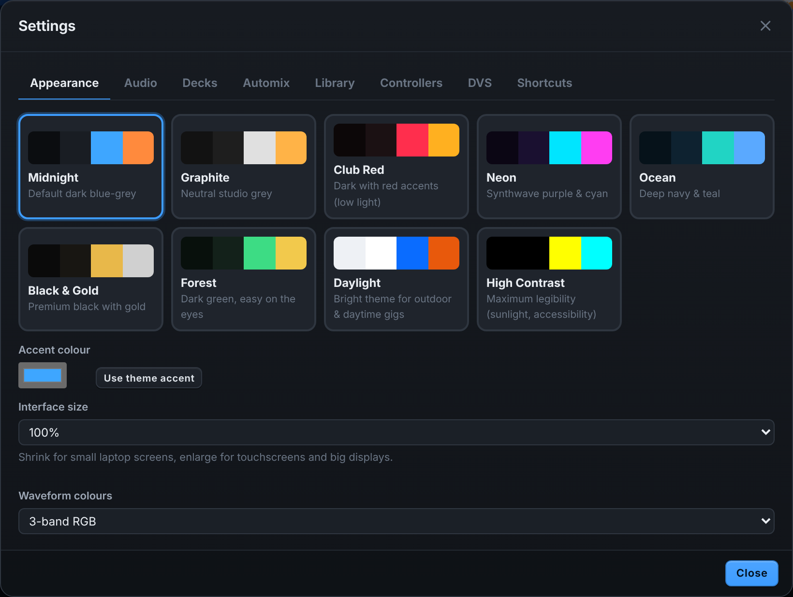</p>

## Download

Get the latest version from **[GitHub Releases](https://github.com/Bucifer6/OpenDJ/releases/latest)**.

| System | File |
|---|---|
| Windows 10/11 (x64) | `OpenDJ-Setup-<version>-x64.exe` (installer) or `OpenDJ-Portable-<version>.exe` (no install) |
| Windows on ARM | `OpenDJ-Setup-<version>-arm64.exe` |
| macOS 11+, Apple Silicon | `OpenDJ-<version>-mac-arm64.dmg` |
| macOS 11+, Intel | `OpenDJ-<version>-mac-x64.dmg` |
| Linux, any distro (x64 / ARM64) | `OpenDJ-<version>-linux-x86_64.AppImage` / `-arm64.AppImage`, or `.tar.gz` |
| Debian / Ubuntu / Mint | `OpenDJ-<version>-linux-amd64.deb` / `-arm64.deb` |
| Fedora / openSUSE (x64) | `.rpm` (when present) |
| NAS / server | Docker, see [below](#docker-recommended) |
| ChromeOS / anything with Chrome or Edge | Browser mode: run `npm run web` on a computer, or use the Docker image |

**First launch: the builds are not code-signed yet.**
- **Windows:** on the SmartScreen prompt choose *More info → Run anyway*.
- **macOS:** right-click the app → *Open* (or *System Settings → Privacy & Security → Open Anyway*).
- **Linux AppImage:** `chmod +x OpenDJ-*.AppImage`, then run it.

Each release has a `SHA256SUMS.txt` so you can check a download wasn't tampered with (`sha256sum -c SHA256SUMS.txt --ignore-missing`). To report a security problem privately, see [SECURITY.md](SECURITY.md).

**Updates:** OpenDJ checks GitHub for a newer release at startup and every 12 hours and offers it with *What's new*, **Update now** and **Later** (never while you're playing, recording or automixing). *Update now* downloads and verifies the installer (Windows, Linux AppImage) or disk image (macOS) against `SHA256SUMS.txt`, opens the matching package for `.deb` / `.rpm` / `.tar.gz` installs and the APK on Android, and shows the Docker commands on a self-hosted server. Turn the check off or run it by hand in *Settings → About*. Privacy: the only request goes to `api.github.com` with the User-Agent `OpenDJ/<version>` (made by the OpenDJ server on the desktop and web app, by the app itself on phones); nothing about you or your library is sent.

Installers are built by GitHub Actions ([`build.yml`](.github/workflows/build.yml)) on Windows, macOS and Linux; pushing a tag like `v0.2.0` publishes a release, and every branch build has the installers under the run's *Artifacts*.

## Quick start

### Desktop app

Install from the [download table](#download), start OpenDJ, then add music (the empty library shows the same options):

- **Folders, USB and NAS**: in the browser's left panel, click a detected drive or use **+ Folder**. NAS shares must be mounted by your OS first (Windows: map a network drive or use `\\nas\music`; macOS: Finder → Go → Connect to Server; Linux: an SMB/NFS mount).
- **Media servers**: click **+ Media server** and pick the type. Plex: server URL plus an X-Plex-Token, or your plex.tv login. Jellyfin, Emby, Subsonic: URL, username and password. MediaMax: URL plus username and password, or an API key (`mmk_…`). Passwords are exchanged for a token where the server supports it.
- **rekordbox users**: in rekordbox use *File → Export Collection in xml format*, then *Settings → Library → Import rekordbox XML* in OpenDJ. Traktor, Serato (crates only, see [Library](#library--media-servers)) and VirtualDJ libraries import from the same tab.

The desktop app keeps its library in `OpenDJ/library` inside the OS app-data folder: `%APPDATA%\OpenDJ\library` (Windows), `~/Library/Application Support/OpenDJ/library` (macOS), `~/.config/OpenDJ/library` (Linux). Set `OPENDJ_DATA` to use another folder (for example a portable library on a USB stick).

### Browser mode (from source)

Requires **Node.js 22+** (music-metadata 12 needs it).

```bash
npm install
npm run web        # then open http://localhost:7380 in Chrome or Edge
```

### Docker

```bash
docker build -t opendj .
docker run -d --name opendj -p 7380:7380 \
  -v opendj-data:/data -v /path/to/music:/music:ro opendj
docker logs opendj   # prints the one-time setup code for choosing the password on first visit
```

Then open `http://<server-address>:7380`. Details in [Run as a web app](#run-as-a-web-app--on-a-nas).

## Mobile apps

OpenDJ also runs as a **standalone iOS and Android app** (phase 1, built with Capacitor from the same UI): no computer
or server needed. Import music from the Files app / Android storage (it is copied into the app, so it plays offline),
let it analyse in the background, mix on two decks (phones) or two/four decks (tablets), make playlists, record your
mix, stream or download from Plex / Jellyfin / Emby / Subsonic, bring cues and playlists over with rekordbox XML, and
export through the share sheet. Playback continues with the screen locked. Lighting, Ableton Link, DVS, MIDI
controllers, CDJ USB export and broadcasting stay desktop-only for now. CI builds the Android APK/AAB and an iOS build
(`.github/workflows/mobile.yml`); try the mobile mode in a browser with `npm run web` and `http://localhost:7380/?local=1`.
Details, build steps and the CI secrets: [docs/MOBILE.md](docs/MOBILE.md).

## Supported formats

| | Formats | Needs |
|---|---|---|
| **Played directly** | MP3, AAC/M4A, FLAC, WAV, Ogg Vorbis, Opus, WebM, AIFF (converted to WAV on the fly) | nothing |
| **Converted on the fly** | ALAC (Apple Lossless `.m4a`), WMA, APE (Monkey's Audio), WavPack (`.wv`), DSD (`.dsf`/`.dff`), AC3/E-AC3, DTS, MP2, AMR, TTA, TAK, Musepack, Speex, MKA, AU/SND, CAF, AIFF-C (compressed), W64/RF64, 3GP | FFmpeg |
| **Video files** (audio track for the decks, picture for video mixing) | MP4, M4V, MOV, WebM play as is; MKV, AVI, WMV, FLV, MPG, TS/M2TS, VOB, OGV are remuxed/converted to MP4 | FFmpeg for the second group |

Converted audio is lossless: it becomes FLAC at the original sample rate (up to 192 kHz; DSD becomes 24-bit / 88.2 kHz PCM). The first load streams while converting; the result is cached in the library data folder (`transcode-cache/`, 4 GB by default, least recently used files are removed first), so reloading and seeking are instant afterwards.

Where FFmpeg comes from:
- **Desktop app**: included (the `ffmpeg-static` build).
- **`npm run web`**: the `ffmpeg-static` binary installed by `npm install`, else `ffmpeg` on your `PATH`. Set `OPENDJ_FFMPEG=/path/to/ffmpeg` to choose one (or `none` to turn conversion off).
- **Docker**: included (Debian's FFmpeg).

Without FFmpeg those formats are still listed in the library, but loading one shows "Install FFmpeg or use the desktop app". Media-server tracks in such formats are converted by your Plex, Jellyfin, Emby or Subsonic server instead. `GET /api/capabilities` reports what the running server supports.

## Run as a web app / on a NAS

OpenDJ can run on a NAS or home server and be opened from any computer's browser. The server holds your library and streams the files; **the audio is mixed and played in the browser**, so plug your headphones and controller into the computer you browse from.

### Docker (recommended)

```bash
docker build -t opendj .
read -rs OPENDJ_PASSWORD && export OPENDJ_PASSWORD   # type a password (8+ characters), or skip this and -e below
docker run -d --name opendj -p 7380:7380 \
  -v opendj-data:/data -v /path/to/music:/music:ro \
  -e OPENDJ_PASSWORD opendj
```

or edit and use [`docker-compose.yml`](docker-compose.yml) (`docker compose up -d`). Then open `http://<nas-address>:7380`.

- `/music` is your music (read-only is fine); `/data` holds the library, analysis, transcode cache and uploads.
- Without `OPENDJ_PASSWORD`, the first visit asks you to choose a password. It needs the one-time setup code printed in the log (`docker logs opendj`), so nobody else on the network can claim the server first.
- `OPENDJ_PASSWORD` must be at least 8 characters; the server refuses to start with a shorter one or with an example value such as `change-me`.

### Without Docker

```bash
npm install
read -rs OPENDJ_PASSWORD && export OPENDJ_PASSWORD   # 8+ characters; or leave it unset and use the setup code from the log
HOST=0.0.0.0 OPENDJ_MUSIC_ROOTS=/srv/music npm run web
# or: node server/cli.js --host 0.0.0.0 --port 7380
```

| Variable | Meaning |
|---|---|
| `HOST` / `--host` | Address to listen on. Default `127.0.0.1` (this computer only). Anything else turns on the login. On `127.0.0.1` there is no password unless one of `OPENDJ_PASSWORD`, `OPENDJ_TRUST_PROXY`, `OPENDJ_ALLOWED_HOSTS` or `OPENDJ_AUTH=1` is set. |
| `OPENDJ_AUTH=1` / `--auth` | Turn on the login (and limit file access to the music roots) even on `127.0.0.1` |
| `PORT` / `--port` | Port, default 7380 |
| `OPENDJ_PASSWORD` | Login password, 8+ characters (otherwise chosen on first visit with the setup code from the log, and stored hashed). Setting it always turns the login on, whatever `HOST` is |
| `OPENDJ_MUSIC_ROOTS` | Folders the web UI may browse, add, import from and export to, separated by `:` (`;` on Windows). Default: `~/Music`, the uploads and downloads folders. Nothing outside them is ever shown. |
| `OPENDJ_DATA` | Library data folder (also honoured by the desktop app) |
| `OPENDJ_UPLOAD_DIR` | Where browser uploads go (default `<data>/Uploads`; it is added to the library as a folder) |
| `OPENDJ_TRUST_PROXY` | Behind a reverse proxy: `1` trusts the proxy that connects to OpenDJ and uses the right-most `X-Forwarded-For` hop for login rate limiting and `X-Forwarded-Proto` for secure cookies. Better: the proxy's address(es), comma-separated (e.g. `172.18.0.1`), so `X-Forwarded-*` is only read from requests that really come through it |
| `OPENDJ_ALLOWED_HOSTS` | Host names the server answers to (e.g. `dj.example.com`, the name your reverse proxy forwards). Turns the login on; the server refuses to start if login is explicitly off |
| `OPENDJ_FFMPEG` | FFmpeg binary, or `none` |

### Desktop app vs web app

| | Desktop app | Web app (browser) |
|---|---|---|
| Adding music | any folder, USB stick or NAS mount on this computer | folders under the music roots on the server, or **upload**: drag audio/video files onto the library, or use **Upload…** |
| Audio output, headphone cue | yes | yes (Chrome/Edge; choosing an output device needs HTTPS or localhost) |
| MIDI controllers, HID, USB DMX | yes | Chrome or Edge, and only over **HTTPS** or on `localhost` (Web MIDI / WebHID / Web Serial are limited to secure pages) |
| Install as an app | n/a | yes, from the browser's address bar (PWA); browsers only offer this over **HTTPS** or on `localhost` |
| Phones | n/a | a simplified layout: one deck at a time (deck tabs) above the mixer, scrolling vertically. Usable for checking the library or a quick mix; for DJing use a tablet (landscape) or a computer |
| Password | none (only reachable from this computer) | required |

### HTTPS with a reverse proxy

Controllers need a secure page, so put a TLS reverse proxy in front when you use OpenDJ from another computer. With [Caddy](https://caddyserver.com) (automatic Let's Encrypt certificates):

```
dj.example.com {
    reverse_proxy 127.0.0.1:7380
}
```

On a home network without a public name, `tls internal` gives a local certificate (trust Caddy's root CA on your laptop once):

```
https://opendj.lan {
    tls internal
    reverse_proxy 127.0.0.1:7380
}
```

Then start OpenDJ behind it. OpenDJ stays on `127.0.0.1` (only Caddy reaches it), so the login is turned on by the
proxy settings, not by `HOST`:

```bash
read -rs OPENDJ_PASSWORD && export OPENDJ_PASSWORD   # 8+ characters; or leave it unset and use the setup code from the log
OPENDJ_TRUST_PROXY=127.0.0.1 OPENDJ_ALLOWED_HOSTS=dj.example.com OPENDJ_MUSIC_ROOTS=/srv/music npm run web
```

`OPENDJ_TRUST_PROXY`, `OPENDJ_ALLOWED_HOSTS` and `OPENDJ_PASSWORD` each turn the login and the music-root limits on
(as do `OPENDJ_AUTH=1` / `--auth`). Sessions use an HttpOnly, SameSite=Strict cookie (marked Secure over HTTPS); failed logins are slowed down per address.

## How OpenDJ compares

OpenDJ covers the core of what rekordbox, Serato, Traktor, VirtualDJ, djay Pro and Engine DJ do for library-based DJing: sync and key tools, hot cues and loops, Color/Beat FX, AI stems, phrase analysis, smart playlists, automix, DVS, Link, video, lighting, recording and broadcasting. Its own strengths are media-server libraries (Plex, Jellyfin, Emby, Subsonic, MediaMax) and self-hosting as a web app.

What's missing, and why:
- **Streaming services** (Beatport, Beatsource, TIDAL, SoundCloud, Apple Music, Spotify) need commercial agreements and DRM.
- **Proprietary hardware protocols** (Pro DJ Link, vendor HID) are not available; controllers work over MIDI, with a starter preset plus MIDI Learn and Mixxx mapping import rather than official plug-and-play mappings.
- **ASIO** is not available; audio goes through WASAPI / CoreAudio / ALSA.
- **Needs testing on real hardware:** DVS absolute mode, CDJ export on a player, and Link with Ableton Live.

The full feature-by-feature table is in **[docs/GAP_ANALYSIS.md](docs/GAP_ANALYSIS.md)**.

## Keyboard shortcuts

| Keys | Action |
|---|---|
| Space | Play/pause deck 1 |
| Z / X / C | Deck 1 cue / play / sync |
| M / , / . | Deck 2 cue / play / sync |
| 1–4, 7–0 | Hot cues A–D on deck 1 / deck 2 (hold Shift to delete) |
| Q / W, O / P | Loop 4 beats / exit, deck 1 / deck 2 |
| ← / → | Crossfader |
| ↑ / ↓ | Browse tracks |
| Shift + ← / → | Load to deck 1 / 2 |
| R | Record |
| A | Automix: start (smart mix of the queue or view) / stop |
| Ctrl+F | Search |

## Building from source & tests

Requires **Node.js 22+** (music-metadata 12 needs it).

```bash
npm install
npm start          # desktop app (Electron)
npm run web        # browser mode on http://localhost:7380
npm run dist       # installers for the OS you're on (Windows/macOS installers must be built on those systems; CI does that)
```

Tests:

```bash
npm test            # unit tests: analysis, media-server clients against mock servers, rekordbox round trip, CDJ export, DVS, Link…
npm run test:e2e    # end-to-end checks in headless Chromium (smoke, performance, controllers, lighting, video, web app, DVS, Link/lyrics, recording, stems, analysis, sampler, automix)
```

The smoke test covers scan → load → analyse → play → sync → FX → record → automix; `scripts/e2e-automix.mjs` checks every mixing style on the master output (dropouts, level, clipping, clicks), smart mix, loading tracks while automix runs and media-server playlists; `scripts/e2e-sampler.mjs [outDir]` renders the sampler bank, measures loudness / spectrum and writes WAVs plus spectrogram PNGs; `node scripts/e2e-performance.mjs` measures pitch for key shift and key lock and checks key sync, quantized cues, saved loops, slicer, instant doubles, stems, Color FX, mic/talkover and the sequencer. `scripts/e2e-update.mjs [shotsDir]` runs the update prompt against a fake GitHub API (`OPENDJ_UPDATE_URL`, tests only, loopback URLs only): newer / same / older versions, *What's new*, Later / Skip, deferral during playback, desktop (mocked IPC and real Electron), hosted and phone modes.

README screenshots are reproducible: `node scripts/demo/make-demo-library.mjs` synthesises the fictional demo library and `node scripts/demo/screenshots.mjs` captures everything in `docs/images/`.

## Architecture

```
electron/           desktop shell (starts the server, native folder picker, MIDI/audio permissions)
server/             Node backend (127.0.0.1 by default; password login when hosted on a network)
  index.js            HTTP API + static UI + server-sent events
  library.js          JSON library store (tracks, playlists, folders, sources, settings)
  scanner.js          folder scanning + tag reading (music-metadata)
  drives.js           USB / NAS / drive detection
  remote.js           media-server sync, streaming proxy, download manager
  sources/            Plex, Jellyfin, Emby, Subsonic, MediaMax clients
  smart.js history.js library-tools.js importers.js   smart playlists, history, prep tools, Traktor/Serato/VirtualDJ import
  stems.js recorder.js broadcast.js lyrics.js transcode.js
  cdj/ lighting/ link/   CDJ device-library export, lighting outputs, Ableton Link
  rekordbox.js m3u.js aiff.js
public/             UI (vanilla ES modules, no build step) - the same UI runs in the desktop app, the web app and the mobile app
  js/local/           on-device backend for the mobile app (the API inside the page: IndexedDB + app file storage)
  js/shared/          logic shared by server/ and js/local/ (library model, smart playlists, media-server clients…)
  js/audio/           engine (mixer graph, routing), deck, AudioWorklets, effects, sampler, sequencer, analysis
  js/ui/              deck, mixer, waveform, library, dialogs, controls, controllers panel
  js/midi/            MIDI learn/mapping engine, presets, Mixxx import, wizard
  js/stems/ js/dvs/ js/video/ js/lighting/ js/recording/ js/cdj/ js/link/ js/lyrics/
  js/automix.js
mobile/             Capacitor iOS / Android projects (see docs/MOBILE.md)
scripts/            end-to-end tests (e2e-*.mjs), README demo tooling (demo/), mobile build helpers
```

Library data lives in your OS app-data folder, or in `OPENDJ_DATA` if set (desktop app and web server alike). Web server (`npm run web`): `%APPDATA%\OpenDJ`, `~/Library/Application Support/OpenDJ`, `~/.config/opendj`. Desktop app: the `library` folder inside Electron's app-data folder (`%APPDATA%\OpenDJ\library`, `~/Library/Application Support/OpenDJ/library`, `~/.config/OpenDJ/library`).

## Contributing

Bug reports, pull requests, controller mappings and tests on real gear are all welcome. See **[CONTRIBUTING.md](CONTRIBUTING.md)** for setup, tests, code style and the PR process. Reports from DVS, CDJ and Ableton Link users are especially useful right now.

## Licence

OpenDJ is released under the **[MIT licence](LICENSE)**.

- Third-party components (FFmpeg via `ffmpeg-static` under GPL-3.0 as a separate executable, Electron, ONNX Runtime Web, music-metadata, fast-xml-parser) are listed in **[THIRD_PARTY_NOTICES.md](THIRD_PARTY_NOTICES.md)**.
- **AI stems model:** the HT-Demucs model is **not bundled**. It is downloaded on demand, only after you agree in the app. Demucs code and weights are released by Meta under the MIT licence, but the packager of the ONNX export used by default describes the weights as being for personal and research use, so check the terms before commercial use, or point the app at a model whose licence suits you.

## Trademarks

rekordbox, CDJ, XDJ and Pioneer DJ are trademarks of AlphaTheta Corporation; Serato is a trademark of Serato Limited; Traktor is a trademark of Native Instruments; Ableton and Ableton Link are trademarks of Ableton AG; VirtualDJ, djay, Engine DJ, Plex, Jellyfin, Emby and other names are trademarks of their respective owners. They are used only to describe compatibility. OpenDJ is an independent project and is not affiliated with, endorsed by or sponsored by any of them.
