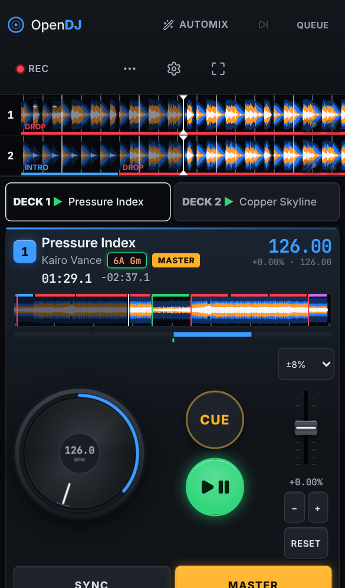
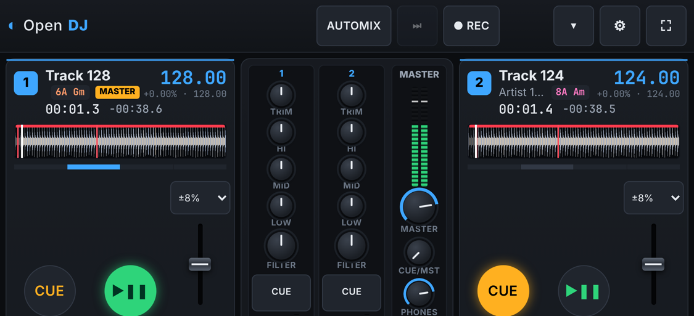
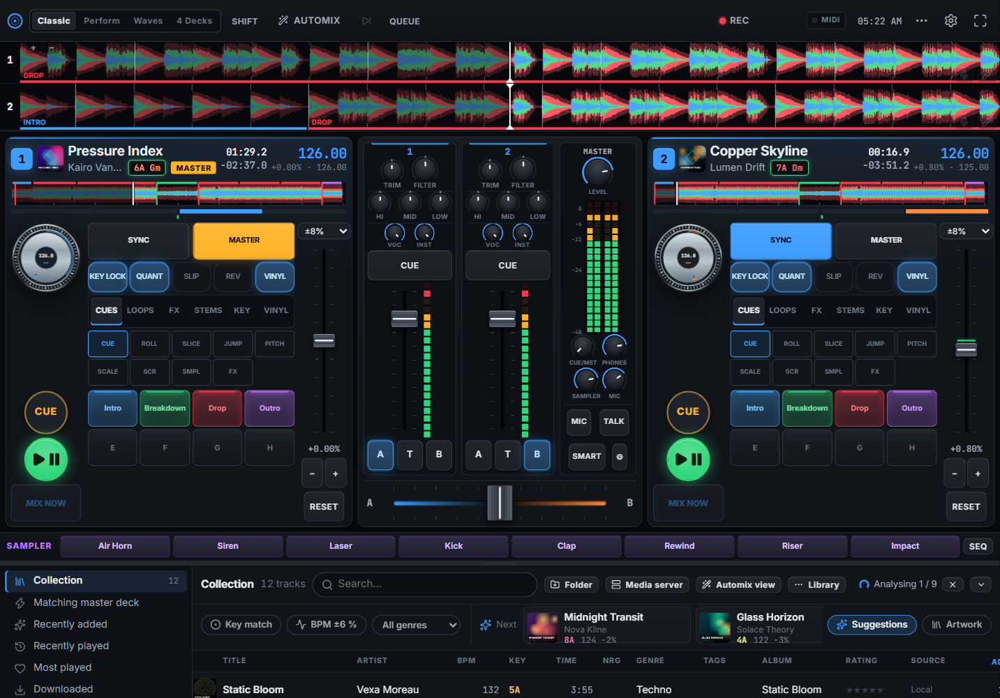

# OpenDJ for iOS and Android

The mobile app is the same OpenDJ UI as the desktop and web app, packaged with [Capacitor 8](https://capacitorjs.com/),
running **completely on the phone or tablet**: library, import, analysis, mixing, playlists, recordings and media-server
downloads need no computer and no OpenDJ server.

> Status: phase 1. The web side is tested in Chromium with phone and tablet emulation (`npm run test:mobile`); the
> native projects are built by CI (`.github/workflows/mobile.yml`). See [What is not verified yet](#what-is-not-verified-yet).

<p> </p>
<p></p>

## Architecture

```
public/                     the one UI codebase (desktop, web app, mobile)
  js/api.js                 API client; imports js/local/boot.js first
  js/platform.js            platform.local / platform.native, feature availability + reasons
  js/local/                 the on-device backend ("server in the page")
    mode.js                 local mode = Capacitor native platform, or ?local=1 in a browser
    boot.js  shim.js        installs the shim: same-origin /api/... fetch, the /api/events EventSource,
                            <a href="/api/..." download> and <audio>/<video> src="/api/..." go to the backend
    dispatcher.js           in-page router with the server's route(method, pattern, handler) shape
    backend.js              the API routes (tracks, import, playlists, history, settings, sources, lyrics…)
    library.js              LocalLibrary / LocalHistory = shared models persisted to IndexedDB
    importer.js             copy-in import, tags + cover art (music-metadata browser build), playlist matching
    sources.js              media servers over CapacitorHttp, download-for-offline (file-transfer)
    recording.js            mix recording (same chunk protocol as server/recorder.js)
    storage/kv.js           IndexedDB key-value store (library JSON, settings, history, lyrics) + memory fake
    storage/fs.js           file store: Capacitor Filesystem (app), OPFS / IndexedDB (browsers), memory (tests)
    share.js                exports: share sheet in the app, download in browsers
    mobile-runtime.js       audio unlock, background playback, keep-awake, Android back button
  js/shared/                isomorphic modules used by BOTH server/ and js/local/ (no node: imports):
                            library-core, settings-schema, smart, history-core, library-tools, sources/*,
                            rekordbox, lyrics-core, recording-core, cues, codec, aiff, hash, m3u
  vendor/opendj-vendor.js   music-metadata (browser), fast-xml-parser, @capacitor/core - built by
                            scripts/build-vendor.mjs and committed (the UI has no build step)
capacitor.config.json       app id io.github.bucifer6.opendj, webDir mobile/www, native projects in mobile/
mobile/www/                 generated copy of public/ (scripts/mobile-sync.mjs; git-ignored)
mobile/android/  mobile/ios/  native projects (npx cap add output + OpenDJ changes, committed)
```

**Why one `mobile/` folder** instead of Capacitor's default `android/` and `ios/` at the root: the root is the
Electron app and the server; keeping all mobile output in `mobile/` (via `android.path` / `ios.path` in the config)
leaves `npm start`, `npm run web`, electron-builder and the Docker image untouched (electron-builder only packs
`electron/ server/ public/`, `.dockerignore` excludes `mobile/`), while still using one `package.json` and one
`node_modules` for the Capacitor CLI and plugins (all `devDependencies`, so they never ship in the desktop app).

**Why a shim instead of a second UI**: about 15 UI files talk to `/api/...` directly (streams, waveforms, covers,
recordings, lyrics, uploads, SSE). The shim takes over exactly those requests in local mode, so desktop and mobile
run the same UI code. Server logic that needs no file system moved to `public/js/shared/` and the server re-exports
it from its old paths, so both backends share the library merge rules, input sanitising, smart playlists, media-server
clients and secret handling.

**Storage**: library JSON in IndexedDB; audio, cover art, waveforms, recordings and downloads in the app's data
directory (Capacitor `Directory.Data`; OPFS in browsers). Media is never read through the JS bridge: the WebView
loads it through Capacitor's file server (`Capacitor.convertFileSrc`), so a 100 MB WAV is streamed into the decoder
once instead of being base64-copied. Picked files are copied into app storage natively by the file-picker plugin.

**Security**: the on-device backend opens no ports and is not reachable from outside the app. Media-server
passwords and tokens live only in app storage, are never sent to the UI (`publicSource`), never written to backups,
stay bound to their endpoint (`sourceConfigFromForm`: a changed URL / user / auth mode needs the password again) and
URL query strings (Subsonic tokens) are stripped from error messages. Android disables cloud backup / device transfer
of app data. The app's CSP is unchanged: Capacitor serves the UI from `capacitor://localhost` / `https://localhost`,
which `'self'` covers (including `convertFileSrc` media URLs); media-server calls go through the native CapacitorHttp
plugin, not the WebView's network, so `connect-src` needed no new hosts. The only `index.html` change is the
viewport meta (no pinch zoom, `viewport-fit=cover` for safe areas).

## What works on mobile

- **Import** (copy-in) from the system picker: MP3, AAC/M4A, WAV, AIFF, FLAC; Ogg/Opus/WebM where the WebView can
  decode them. Tags and cover art are read on the device; the background analysis then finds BPM, key, beat grid,
  waveform and cues. Re-importing the same file is recognised.
- Decks (2 or 4), mixer, EQ/filter/FX, sync, hot cues, loops, slicer, sampler, sequencer, automix, key sync.
- Playlists, smart playlists, crates by tags/colours, history sessions, duplicates, missing files.
- **rekordbox XML** and **M3U** import: entries are matched to music you imported (by file name, then file name
  without extension, then artist + title), cues / grids / colours / playlists are applied.
- **Exports** through the share sheet (Save to Files, AirDrop, Drive, mail…): playlists as M3U8 (entries named
  after the imported files), the collection as rekordbox XML, setlists (TXT/CSV/M3U8), library backup.
- **Recording**: WAV always; AAC (`.m4a`) or Opus where the WebView's MediaRecorder supports it. Cue sheet +
  tracklist. Recordings are listed in the app and shared from the Recordings tab.
- **Media servers** (Plex, Jellyfin, Emby, Subsonic/Navidrome, MediaMax): browse, stream (cached), download for
  offline use into app storage.
- Lyrics (embedded tags, media servers, LRCLIB when turned on), themes, settings, backup / restore.
- Playback with the **screen locked** (iOS background audio; Android foreground service), screen kept on while
  playing, Android back button closes dialogs instead of quitting.

## What is disabled on mobile, and why

Hidden in local mode (`public/js/platform.js`), explained in **Settings → Mobile**:

| Feature | Why |
|---|---|
| Library folders / folder scanning | Phones have no shared music folder an app may scan (iOS has none at all): import copies files in instead. |
| Lighting (DMX over Art-Net / sACN, OSC) | Needs UDP sockets; the WebView has none. WLED / Hue over HTTP could use CapacitorHttp later. |
| Ableton Link | UDP multicast on the local network. |
| DVS (timecode vinyl) | Needs a multichannel audio interface with line inputs; maybe later. |
| MIDI controllers | WKWebView and the Android WebView have no Web MIDI; a native MIDI plugin is planned. |
| CDJ USB export, export to USB folder | Writes directly to a USB drive; use the desktop app (rekordbox XML export works). |
| Live broadcasting (Icecast / Shoutcast / RTMP) | Needs FFmpeg and raw sockets (desktop app or server). |
| AI stems | 174 MB model and desktop-class CPU / memory. |
| Video mixer / projector output | Needs a second screen. |
| Traktor / Serato / VirtualDJ import | Their files point at folders on a computer; use rekordbox XML or M3U. |
| Hosted-mode login / upload | No server: everything is on the device. |
| Formats needing FFmpeg (WMA, APE, ALAC on Android, DSD, …) | No FFmpeg in phase 1; refused at import with a clear message. `checkFormat(…, { transcoder })` in `js/local/media.js` is the hook for a later ffmpeg.wasm. |

## Import on iOS vs Android

- **iOS** has no user-visible music folder an app may read (the Music app's library is DRM-managed). **Import**
  opens the Files picker: iCloud Drive, *On My iPhone*, USB drives / SD readers on the Lightning/USB-C port, and
  cloud providers (Dropbox, Google Drive, OneDrive…). The picker hands OpenDJ a temporary copy; OpenDJ copies it
  into its own storage, so the music stays available offline. Folder import is not offered on iOS yet: select the
  files (multi-select works).
- **Android**: **Import** opens the system document picker (Downloads, Music, SD card, USB OTG drives, Drive…). The
  file is copied into app storage the same way; nothing outside the app is read later, so no storage permission
  is needed.
- In both cases, removing a track from the library deletes OpenDJ's copy, never the original file.
- Bring your prep from the desktop: export rekordbox XML (or M3U) there, import the music on the phone, then
  import the XML: cues, grids, colours and playlists are applied to the matching tracks.

## Mobile UX

- Phones in portrait: one deck at a time (deck tabs) above a compact mixer; the page scrolls inside the app (no
  rubber-banding: iOS `scrollEnabled: false`, `overscroll-behavior`). Phones in landscape: both decks around the
  mixer. Tablets: the 2/4-deck desktop layout (landscape) or deck tabs next to the mixer (portrait).
- Compact screens are laid out at their real size (no more shrinking the desktop layout); deck buttons, pads,
  transport and deck tabs are at least 44 px on touch screens (library rows 40 px). Jog wheels, knobs and faders use pointer
  events with `touch-action: none`. Safe-area insets (notch, home indicator, Android edge-to-edge via SystemBars
  `insetsHandling: css`) pad the app. Pinch zoom is off. Audio is unlocked on the first touch.
- Mid-range phones: the e2e suite runs the Pixel 7 profile with 4x CPU throttling while two decks play and a new
  import is analysed, and checks the UI keeps updating.

## Building locally

Prerequisites: Node 22, `npm install`.

```bash
npm run mobile:sync        # copy public/ to mobile/www and run `npx cap sync` (after every UI change)
npm run mobile:android     # sync + open Android Studio
npm run mobile:ios         # sync + open Xcode (macOS)
npm run test:mobile        # the on-device backend in Chromium with phone/tablet emulation
npm run mobile:vendor      # rebuild public/vendor/opendj-vendor.js after updating music-metadata / fast-xml-parser / @capacitor/core
```

- **Android Studio** (Ladybug or newer, JDK 21, Android SDK 36): open `mobile/android`, run on a device or emulator.
  Command line: `cd mobile/android && ./gradlew assembleDebug` (APK in `app/build/outputs/apk/`).
- **Xcode 16+** (iOS 16+ target): open `mobile/ios/App/App.xcodeproj` (Swift Package Manager resolves the plugins
  from `node_modules`), choose your team under *Signing & Capabilities*, run. Command line simulator build:
  `xcodebuild -project mobile/ios/App/App.xcodeproj -scheme App -sdk iphonesimulator -destination 'generic/platform=iOS Simulator' CODE_SIGNING_ALLOWED=NO build`.
- Try the mobile mode without a phone: `npm run web`, then open `http://localhost:7380/?local=1` (the server only
  serves the files; the library lives in the browser's IndexedDB / OPFS).
- Debugging: Safari → Develop → (device) for iOS; `chrome://inspect` for Android (set
  `"webContentsDebuggingEnabled": true` in `capacitor.config.json` for release builds).

## CI and secrets

`.github/workflows/mobile.yml` runs on pushes, pull requests and manually:

- **web**: unit tests and a check that the vendor bundle is up to date.
- **android**: release APK + AAB (artifact `OpenDJ-Android`). Signed with your release key when the keystore
  secrets exist, otherwise with the debug key (installable for testing, not accepted by Google Play).
- **ios**: unsigned simulator build (proves it compiles). With the Apple secrets also a signed App Store archive,
  exported IPA and a TestFlight upload.
- **release-android**: on *Run workflow* with `release_tag`, attaches the APK to that GitHub Release.

| Secret | Used for |
|---|---|
| `ANDROID_KEYSTORE_BASE64` | release keystore (`base64 -w0 release.jks`) |
| `ANDROID_KEYSTORE_PASSWORD` | keystore password |
| `ANDROID_KEY_ALIAS` | key alias |
| `ANDROID_KEY_PASSWORD` | key password (optional: defaults to the keystore password) |
| `APPLE_TEAM_ID` | Apple Developer team id |
| `IOS_DIST_CERT_P12_BASE64` | Apple Distribution certificate + private key, `.p12`, base64 |
| `IOS_DIST_CERT_PASSWORD` | password of that `.p12` |
| `IOS_PROVISIONING_PROFILE_BASE64` | App Store provisioning profile for `io.github.bucifer6.opendj`, base64 |
| `APP_STORE_CONNECT_API_KEY_ID` | App Store Connect API key id (TestFlight upload) |
| `APP_STORE_CONNECT_API_ISSUER_ID` | its issuer id |
| `APP_STORE_CONNECT_API_KEY_P8` | the `AuthKey_XXXX.p8` file contents |

The Android build number is derived from the version in `package.json` (major·1000000 + minor·10000 + patch·100;
override with `ANDROID_VERSION_CODE`); the iOS build number is the workflow run number.

Create the Android keystore once: `keytool -genkeypair -v -keystore release.jks -alias opendj -keyalg RSA -keysize 4096 -validity 10000`
(keep it safe: Google Play needs the same key for every update, or use Play App Signing).

## What is not verified yet

Built and checked here: the web side (unit tests; e2e in Chromium with iPhone 13, Pixel 7 and iPad landscape
emulation, including OPFS/IndexedDB persistence, recording, exports and 4x CPU throttling), `npx cap add` / `npx cap
sync`, and the YAML / plist syntax. The sandbox used to build phase 1 could not download the Android SDK or run
Xcode, so these are correct by construction but only CI / a device can prove them:

- the Gradle build (AGP 8.13 / Gradle 8.14.3 from Capacitor 8's template) and the Java of `PlaybackService` /
  `OpenDJAudioPlugin`; the Xcode build (Swift Package Manager, `AppDelegate` audio session);
- background playback with the screen locked on real devices (iOS WKWebView with Web Audio; Android foreground
  service), lock-screen metadata, keep-awake;
- native plugin calls: file picker copy into app storage (fallback: streaming through `convertFileSrc`), share
  sheet with files from app storage (Android FileProvider `files-path`), file-transfer downloads, CapacitorHttp
  against real media servers (iOS ATS allows plain HTTP only on the local network; Android allows cleartext);
- audio latency and performance on real mid-range hardware; MediaRecorder AAC/Opus availability per OS version;
- the signed iOS archive / TestFlight and signed Android steps (they only run when the secrets exist).

## Scratching on a phone or tablet
- **Scratch view:** tap SCRATCH in a deck header (or double-tap the header) for a full-screen platter with a crossfader strip on your thumb side (*Settings → Decks → Scratch view crossfader*), a CUT button for transforms, the scratch-sample pads and the estimated touch-to-sound latency. Use wired headphones: Bluetooth adds 100 ms or more.
- **Multitouch:** one finger scratches, a second finger anywhere on the platter holds the record still. Fingers on the platter and the crossfader / CUT work at the same time.
- **Haptics:** a groove tick while scratching and a bump on hot cues (*Settings → Decks → Haptic feedback*: Off, Subtle, Full). The apps use `@capacitor/haptics`; Android browsers use `navigator.vibrate`; iOS Safari has no vibration API.
- **Needle lock** is on by default on phones: a playing deck needs a short press-and-hold on the overview waveform before the needle drops.
- Phones and 4-deck layouts show a simplified version of the Direct-Drive Turntable and Pro Media Player deck skins.
